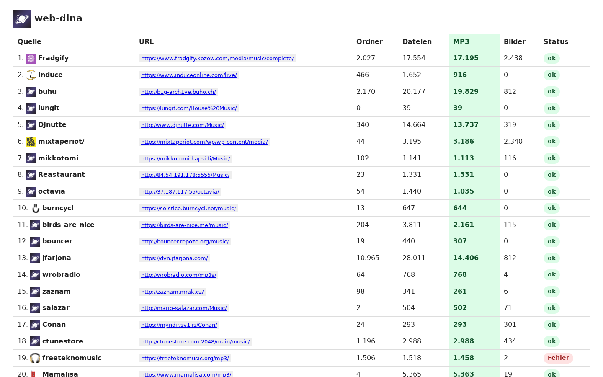
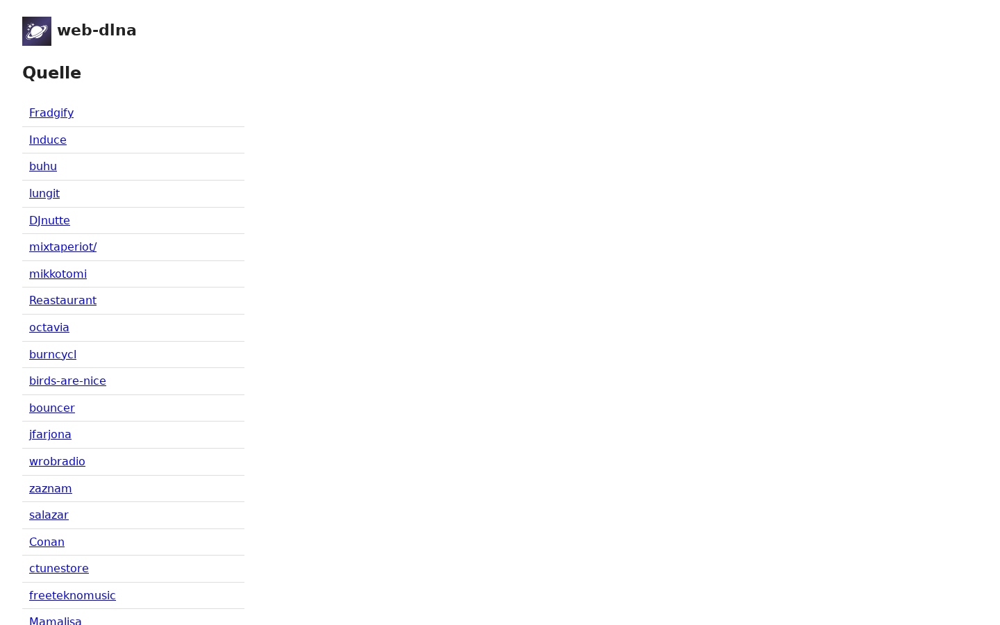
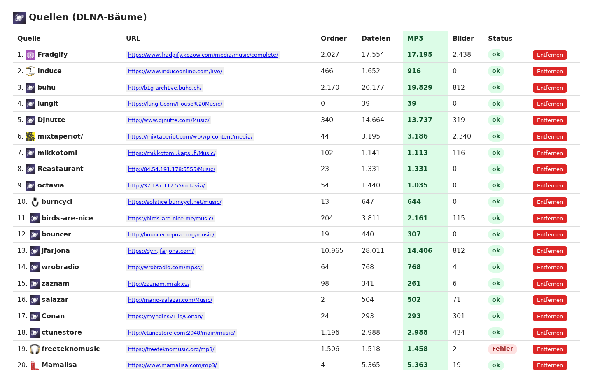

# web-dlna

Ein DLNA/UPnP-Mediaserver, der viele öffentlich erreichbare MP3-Autoindex-Quellen als **einen** Medienserver bündelt. Dieses Repository enthält den kompletten Servercode, die Web-Oberfläche und einen **vorbereiteten Index** aller eingerichteten MP3-Quellen. Das Docker-Image wird bei jedem Push auf `main` per GitHub Actions nach **GitHub Container Registry (GHCR)** veröffentlicht.

> **English:** web-dlna is a DLNA/UPnP media server that combines 52 public MP3 autoindex sources into a single library. This repository contains the complete server code, the web UI and a prebuilt index with **477,276 MP3 entries**. Docker images are published to GHCR on every push to `main`. The image contains **no audio files, no download history and no personal data** – only index metadata and source definitions.

**Image:** `ghcr.io/cosmicboy6/web-dlna:latest`  
**Weboberfläche:** `http://<host>:9092/`  
**DLNA-Name (Standard):** `web-dlna`  
**Version:** `1.0.0`

> **Wichtig:** Das Image enthält **keine Audiodateien**. Enthalten sind nur Index-Metadaten (IDs, Pfade, Namen, Cover-Pfade) und die Quellkonfiguration. Keine Downloads, keine Download-Historie, keine DLNA-UUID, keine Backups und keine persönlichen Daten.

---

## Screenshots

| Dashboard | Downloads |
| :---: | :---: |
|  |
|  |  |

---

## Inhaltsverzeichnis

- [Screenshots](#screenshots)
- [Funktionen](#funktionen)
- [Schnellstart](#schnellstart)
- [Docker Compose](#docker-compose)
- [Netzwerk und Ports](#netzwerk-und-ports)
- [Umgebungsvariablen](#umgebungsvariablen)
- [Volumes und Datenhaltung](#volumes-und-datenhaltung)
- [Enthaltene MP3-Indexe](#enthaltene-mp3-indexe)
- [Web-Oberfläche](#web-oberfläche)
- [HTTP-API](#http-api)
- [Index aktualisieren](#index-aktualisieren)
- [Lokal bauen](#lokal-bauen)
- [Image veröffentlichen](#image-veröffentlichen)
- [Datenschutz](#datenschutz)
- [Fehlerbehebung](#fehlerbehebung)

---

## Funktionen

- **DLNA/UPnP MediaServer** mit `ContentDirectory` und `ConnectionManager`.
- **Multi-Source:** 52 eingerichtete Quellen, u. a. Beelody 2018–2026, Fradgify, Induce, Mamalisa, WNCDC, Words und weitere.
- **Vorbefüllter Index:** beim ersten Start ist die gesamte Bibliothek sofort durchsuchbar; es wird kein initiales Crawlen benötigt.
- **Direktes Streaming:** Audio und Cover werden per HTTP von der Originalquelle geladen (Range Requests werden unterstützt). Der Server proxyrt nichts und speichert standardmäßig nichts.
- **Genre-Browser** über `/genres`.
- **M3U-Playlists** über `/playlist.m3u`.
- **Player-Demo** über `/demo/player`.
- **Download-Manager** über `/downloads`: ausgewählte Ordner oder Dateien werden nach `/music` geladen, mit Fortschritt, Wiederholungen, Abbruch, Deduplizierung und Anzeige des freien Speichers.
- **Mehrsprachige Oberfläche:** Deutsch, Französisch, Englisch, Spanisch, Chinesisch und Hindi.
- **Admin-Oberfläche** über `/admin` zum Hinzufügen/Entfernen von Quellen.
- **Health-Check** über `/health`.

---

## Schnellstart

Voraussetzung: Linux mit Docker (für DLNA-Erkennung wird Host-Netzwerk empfohlen).

```bash
docker pull ghcr.io/cosmicboy6/web-dlna:latest

mkdir -p /srv/web-dlna/data /srv/music

docker run -d \
  --name web-dlna \
  --restart=always \
  --network=host \
  -e TZ=Europe/Berlin \
  -e FRADGIFY_DLNA_IP=192.168.0.68 \
  -e FRADGIFY_WORKERS=16 \
  -e FRADGIFY_MUSIC=/music \
  -v /srv/web-dlna/data:/data \
  -v /srv/music:/music \
  ghcr.io/cosmicboy6/web-dlna:latest
```

Danach:

- Weboberfläche: `http://192.168.0.68:9092/`
- Status: `http://192.168.0.68:9092/health`
- Index-Übersicht: `http://192.168.0.68:9092/api/summary`
- DLNA-Status: `http://192.168.0.68:9092/dlna/status`

`FRADGIFY_DLNA_IP` bitte an die eigene Host-IP anpassen. Ohne Angabe versucht der Server, die IP automatisch zu erkennen; bei mehreren Interfaces ist die explizite Angabe zuverlässiger.

---

## Docker Compose

```yaml
services:
  web-dlna:
    image: ghcr.io/cosmicboy6/web-dlna:latest
    container_name: web-dlna
    restart: always
    network_mode: host
    environment:
      TZ: Europe/Berlin
      FRADGIFY_DLNA_IP: 192.168.0.68
      FRADGIFY_WORKERS: "16"
      FRADGIFY_MUSIC: /music
    volumes:
      - /srv/web-dlna/data:/data
      - /srv/music:/music
```

`docker compose up -d` startet den Server.Da `network_mode: host` verwendet wird, sind `ports:` nicht nötig und auch nicht sinnvoll.

---

## Netzwerk und Ports

| Port | Protokoll | Zweck |
| --- | --- | --- |
| `9092` | TCP | Weboberfläche, Admin, API, DLNA-HTTP, SOAP und Medien-URLs |
| `1900` | UDP | SSDP Discovery (`239.255.255.250`) |

Die SSDP-Ankündigung zeigt auf `http://<host>:9092/dlna/device.xml`. Für die Erkennung durch TV, Receiver oder Kontroll-Apps muss der Container die Multicast-Gruppe sehen. Unter Linux ist `--network=host` daher die empfohlene Variante. Bei Bridge-Netzwerk können `9092/tcp` und `1900/udp` veröffentlicht werden, die Geräteerkennung funktioniert dann aber je nach Docker-/Host-Setup nicht zuverlässig.

Der Server benötigt **keinen** ausgehenden Proxies oder besonderen Port für die Audio-Wiedergabe: Die Medien-URLs zeigen direkt auf die Quellwebsites. Für den Download-Manager sind ausgehende HTTPS-Verbindungen zu den Quellen nötig.

---

## Umgebungsvariablen

| Variable | Standard | Beschreibung |
| --- | --- | --- |
| `FRADGIFY_PORT` | `9092` | HTTP-Port für UI, API und DLNA. |
| `FRADGIFY_DLNA_NAME` | `web-dlna` | Angezeigter DLNA-Gerätename. |
| `FRADGIFY_DLNA_IP` | auto | IP, die in SSDP/DLNA-URLs bekannt gegeben wird. |
| `FRADGIFY_NOTIFY` | `30` | Sekunden zwischen SSDP-Alive-Ankündigungen (Minimum: 5). |
| `FRADGIFY_WORKERS` | `10` | Parallel laufende Crawler-/Download-Threads. |
| `FRADGIFY_DATA_DIR` | `/data` | Beschreibbares Verzeichnis für `sources.json`, `library.json`, `download_history.json`. |
| `FRADGIFY_INDEX_DIR` | `/index` | Im Image enthaltenes, schreibgeschütztes Index-Verzeichnis. |
| `FRADGIFY_MUSIC` | `/music` | Zielverzeichnis für den Download-Manager. |
| `FRADGIFY_WEB_DIR` | `./web` | Pfad zu den Web-Assets; im Image bereits gesetzt. |
| `TZ` | `Europe/Berlin` | Zeitzone für Logs und Zeitstempel. |

Beispiel zum Deaktivieren des mitgelieferten Index (frisch crawlen):

```bash
-e FRADGIFY_INDEX_DIR=/does-not-exist
```

Danach `/data/library.json` löschen und `POST /api/refresh` aufrufen.

---

## Volumes und Datenhaltung

| Pfad | Inhalt | Beschreibbar | Im Image enthalten |
| --- | --- | --- | --- |
| `/index` | `sources.json`, `library.json.gz` | nein | ja |
| `/data` | Laufzeitstatus, eigene Quellen, gecrawlter Index, Download-Historie | ja | nein |
| `/music` | Heruntergeladene MP3-Dateien | ja | nein |

Beim ersten Start lädt der Server, falls `/data/sources.json` fehlt, die Quellliste aus `/index/sources.json` und speichert sie beim ersten Editieren unter `/data/sources.json`. Ebenso wird der komprimierte Index aus `/index/library.json.gz` gelesen. Sobald der Server einen neuen Index speichert, liegt `/data/library.json` vor und hat Vorrang.

**Nicht im Image enthalten:**

- `download_history.json`
- `dlna.uuid`
- `library.json` unkomprimiert (nur komprimiert als `.gz`)
- Backups wie `sources.json.bak-*`
- MP3-, Cover- oder sonstige Mediendateien

---

## Enthaltene MP3-Indexe

Der Index ist ein Snapshot vom **2026-11-10 02:50 UTC**. Er umfasst **52 Quellen** und **477.276 MP3-Einträge** (plus Verzeichnis- und Cover-Metadaten). Die komprimierte Datei `data/library.json.gz` ist ca. 17 MB; das Auspacken zur Laufzeit ist nicht nötig.

| ID | Name | MP3-Einträge |
| --- | --- | ---: |
| `beelody2018` | beelody2018 | 14.512 |
| `beelody2019` | beelody2019 | 27.704 |
| `beelody2020` | beelody2020 | 7.828 |
| `beelody2021` | beelody2021 | 50.345 |
| `beelody2022` | beelody2022 | 38.954 |
| `beelody2023a` | beelody2023a | 20.427 |
| `beelody2023b` | beelody2023b | 16.804 |
| `beelody202401` | beelody202401 | 1.846 |
| `beelody202402` | beelody202402 | 2.167 |
| `beelody202403` | beelody202403 | 2.398 |
| `beelody202404` | beelody202404 | 1.541 |
| `beelody202405` | beelody202405 | 2.322 |
| `beelody202406` | beelody202406 | 520 |
| `beelody202407` | beelody202407 | 1.356 |
| `beelody202408` | beelody202408 | 1.158 |
| `beelody202409` | beelody202409 | 2.393 |
| `beelody202410` | beelody202410 | 3.147 |
| `beelody202411` | beelody202411 | 3.533 |
| `beelody202412` | beelody202412 | 3.122 |
| `beelody2024hit` | beelody2024hit | 858 |
| `beelody202503` | beelody202503 | 638 |
| `beelody2026` | beelody2026 | 24.172 |
| `birds-are-nice` | birds-are-nice | 3.811 |
| `bouncer` | bouncer | 440 |
| `buhu` | buhu | 20.177 |
| `burncycl` | burncycl | 647 |
| `cargo-foxtrot` | Cargo Foxtrot | 50 |
| `cats-4-sale` | Cats 4 Sale | 9 |
| `conan` | Conan | 293 |
| `ctunestore` | ctunestore | 2.988 |
| `djnutte` | DJnutte | 14.664 |
| `doctormacro` | doctormacro | 1.325 |
| `fauxharmonic` | Fauxharmonic | 159 |
| `fradgify` | Fradgify | 17.554 |
| `freeteknomusic` | freeteknomusic | 1.518 |
| `gva` | gva | 3.862 |
| `heart-of-grace` | Heart of Grace | 242 |
| `induce` | Induce | 1.652 |
| `jfarjona` | jfarjona | 28.011 |
| `jucciz` | Jucciz | 1.077 |
| `lungit` | lungit | 39 |
| `mamalisa` | Mamalisa | 5.365 |
| `mikkotomi` | mikkotomi | 1.141 |
| `mixtaperiot` | mixtaperiot/ | 3.195 |
| `octavia` | octavia | 1.440 |
| `reastaurant` | Reastaurant | 1.331 |
| `salazar` | salazar | 504 |
| `unrec` | unrec | 97 |
| `wncdc` | WNCDC | 1.347 |
| `words` | words | 135.484 |
| `wrobradio` | wrobradio | 768 |
| `zaznam` | zaznam | 341 |
| **Gesamt** |  | **477.276** |

Beelody-Hinweise: Die Jahre 2023 und 2024 sind aus technischen Gründen aufgeteilt (`2023a`/`2023b` bzw. einzelne Monatsquellen). Beelody `2025` ist bis auf `beelody202503` nicht crawlbar (die Quelle liefert dort nur einen UTF-16-BOM). Veraltete Index-IDs aus früheren Namensschemata wurden entfernt.

---

## Web-Oberfläche

| URL | Funktion |
| --- | --- |
| `/` | Dashboard mit Quellen, Index-Status und Refresh-Aktionen. |
| `/genres` | Genre-Browser über die INDEX-ID3-Tags der Quellen. |
| `/downloads` | Download-Manager inklusive Anzeige des freien Speichers auf `/music`. |
| `/admin` | Quellen hinzufügen/entfernen; Änderungen werden nach `/data/sources.json` geschrieben. |
| `/demo/player` | Kleiner HTML-Player zum Testen der Streams. |
| `/playlist.m3u` | M3U-Playlist erzeugen, z. B. `?sid=fradgify` oder `?sid=beelody202412&rel=...`. |

Die Oberfläche ist bewusst einfach gehalten und **nicht authentifiziert**. Der Server ist für ein lokales Netz gedacht; nicht direkt ins Internet exponieren.

---

## HTTP-API

| Methode | Endpoint | Beschreibung |
| --- | --- | --- |
| `GET` | `/health` | `{ "ok": true, "version": "1.0.0" }` |
| `GET` | `/api/summary` | Liste aller Quellen mit `id`, `name`, `base_url`, Zählungen und `building`. |
| `POST` | `/api/refresh` | Alle Quellen neu crawlen (asynchron, Antwort `202`). |
| `POST` | `/api/refresh?sid=fradgify&sid=words` | Nur ausgewählte Quellen neu crawlen. |
| `GET` | `/api/downloads` | Aktuell laufende und abgeschlossene Download-Jobs. |
| `POST` | `/api/download?sid=<id>&g=<url-kodierter Pfad>` | Download eines Ordners oder einer Datei starten. |
| `GET` | `/download/cancel?id=<id>` | Download-Job abbrechen. |
| `GET` | `/dlna/status` | DLNA-Name, UUID und Location-URL. |

Beispiel:

```bash
curl -X POST 'http://192.168.0.68:9092/api/refresh?sid=beelody202412'
curl 'http://192.168.0.68:9092/api/summary' | jq '.sources[] | {id, mp3, building}'
```

---

## Index aktualisieren

Der mitgelieferte Index ist ein Snapshot. Quellen ändern sich laufend; zum Aktualisieren:

```bash
# alle Quellen
curl -X POST 'http://192.168.0.68:9092/api/refresh'

# nur einzelne Quellen, mehrfach angeben
curl -X POST 'http://192.168.0.68:9092/api/refresh?sid=beelody202412&sid=words'
```

Der Refresh läuft im Hintergrund. `/api/summary` zeigt `building: true`, solange eine Quelle bearbeitet wird. Nach Abschluss wird `/data/library.json` geschrieben und beim nächsten Start gegenüber dem gebündelten Index bevorzugt.

**Achtung:** Ein Neustart des Containers bricht laufende Crawls und Downloads ab. Nach einem funktionierenden Refresh nicht mitten im Vorgang neu starten.

---

## Lokal bauen

```bash
git clone https://github.com/cosmicboy6/web-dlna.git
cd web-dlna
docker build -t web-dlna:local .

docker run -d --name web-dlna --restart=always --network=host \
  -e FRADGIFY_DLNA_IP=192.168.0.68 \
  -v "$PWD/data:/data" \
  -v "$PWD/music:/music" \
  web-dlna:local
```

## Image veröffentlichen

Der Workflow `.github/workflows/docker-publish.yml` baut und pusht bei jedem Push auf `main` automatisch:

- `ghcr.io/cosmicboy6/web-dlna:latest`
- `ghcr.io/cosmicboy6/web-dlna:sha-<kurzer-commit-hash>`

Dafür nutzt er das `GITHUB_TOKEN` des Repositories mit `packages: write`; ein separater Registry-Token ist nicht nötig. Der Workflow setzt das Package zudem auf **public**, sodass `docker pull` ohne Login funktioniert.

Manuell auslösen: GitHub → **Actions** → **Publish Docker image to GHCR** → **Run workflow**.

Falls du lokal ohne Actions bauen willst:

```bash
docker login ghcr.io -u cosmicboy6           # Classic-PAT mit write:packages
docker build -t ghcr.io/cosmicboy6/web-dlna:latest .
docker push ghcr.io/cosmicboy6/web-dlna:latest
```

Das `latest`-Tag zeigt immer auf den zuletzt veröffentlichten Stand dieses Repositories.

---

## Datenschutz

- Keine Audiodateien im Image.
- Keine Download-Historie im Image.
- Keine Geräte-, Benutzer- oder Zugangsdaten im Image.
- Quellen sind öffentlich erreichbare HTTP(S)-Autoindex-Verzeichnisse; die Index-Einträge enthalten nur Pfad, Anzeigename und ggf. Cover-Pfad.
- Die Weboberfläche hat keine Login-Funktion. Zugriff daher nur im vertrauten LAN oder hinter einer Reverse-Proxy-Authentifizierung erlauben.
- Heruntergeladene Dateien liegen ausschließlich im gemounteten `/music`-Verzeichnis.

---

## Fehlerbehebung

**DLNA-Gerät findet den Server nicht**  
Host-Netzwerk prüfen, `FRADGIFY_DLNA_IP` korrekt setzen und UDP 1900 zulassen. `curl http://<host>:9092/dlna/status` muss `uuid` und `location` zeigen.

**Index wird nicht geladen**  
`curl http://<host>:9092/api/summary` prüfen. Wenn `mp3: 0` angezeigt wird, wurde entweder ein leerer `/data`-Stand mit deaktiviertem `/index` verwendet oder der Refresh läuft noch. `POST /api/refresh` erneut aufrufen.

**Downloads bleiben bei 0/0 stehen**  
Seit Version 1.0.0 werden Pfade dekodiert verglichen; das behebt Quellen, die Klammern oder Umlaute anders kodieren. Zusätzlich wird gzip für große Apache-Listen verwendet, wodurch `IncompleteRead`-Abbrüche bei großen Verzeichnissen vermieden werden. Falls weiterhin Fehler auftreten: `/api/downloads` enthält die konkrete Fehlermeldung pro Job.

**Download-Ziel voll**  
Die Anzeige oben auf `/downloads` nutzt `shutil.disk_usage(/music)`. Der Wert entspricht dem gemounteten ZielVolume. Bei Bedarf `FRADGIFY_MUSIC` auf ein größeres Volume legen.

**Quelle nicht erreichbar**  
Einige Quellen (insbesondere Beelody 2025) liefern nur einen UTF-16-BOM und können nicht indexiert werden. `/api/summary` zeigt die Quelle zwar, aber mit `mp3: 0`. Solche Quellen bitte entfernen oder auf monatliche URLs umstellen.

---

## Lizenz / Haftung

Dieses Projekt bündelt Index-Metadaten öffentlich erreichbarer Web-Verzeichnisse. Es werden keine Audioinhalte redistribuiert. Die verfügbaren Inhalte und deren Nutzungsbedingungen liegen bei den jeweiligen Quellenbetreibern.
